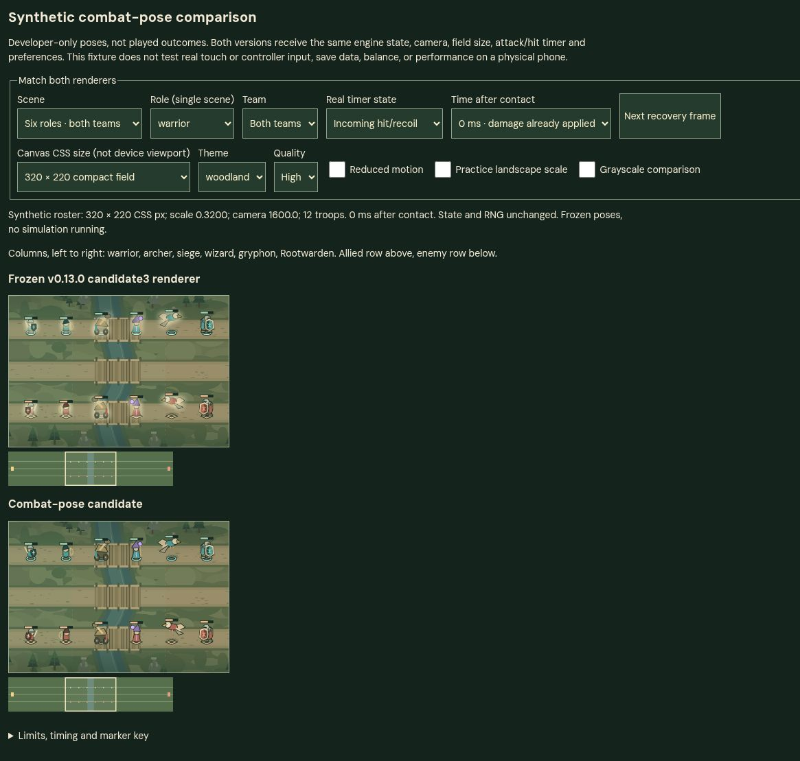

# Combat feedback native visual review

Date: 6 November 2026. **Final targeted verdict: corrected candidate passes this synthetic visual gate. Live-play and device review remain outstanding.**

Initial candidate verdict: **needs correction; reject the hit-glow removal, retain the contact/recovery poses for targeted retest**.

## Review identity and method

Native Chrome screenshots of `http://127.0.0.1:4173/__qa_combat_feedback/`, served from the isolated `/workspace/shared/ironroot-feedback-preview` copy. The managed server was neither started nor stopped by this reviewer. No production page, profile, save, source renderer or engine was modified.

The initially reviewed preview files were verified after capture:

- `dist/render.js`: `7c0fcc874c056f172f88b23ca657fe6c02aaec8ebe1f21330ece1c7d16cac1e4`
- `dist/combat-feedback.js`: `6e6a6d7478fc7cb76ee92273101b4e5aa2b2bbf817046d279a79a9cd92f30c96`
- The fixture manifest pins the v0.13.0 candidate3 original renderer to `d641e2b2a2ed8403441e98eb6ba5baa7455eb0cfb1795d804b00b73e491fa3aa`, with its three declared import substitutions. The upper canvas is that frozen baseline; the lower canvas is the candidate.

All findings below concern identical **synthetic frozen states**, not played combat. Field dimensions are CSS canvas sizes, not physical-device viewports. Visual parity means no visible difference in this inspection, not a pixel-hash or source-parity proof. The fixture's visible state/RNG status remained unchanged after every inspected selection.

## Blocking finding: incoming-hit salience regresses

**CFV-1, acceptance blocker:** replacing the baseline incoming-hit glow with restrained recoil makes struck troops materially harder to identify in normal-motion, high-quality scenes.

Reproduction:

1. Scene: Six roles · both teams.
2. Real timer state: Incoming hit/recoil; time: 0 ms.
3. Size: 320 × 220; theme: woodland; quality: High.
4. Reduced motion, practice scale and grayscale: off.
5. Compare upper and lower canvases, especially warrior, archer, siege, wizard and gryphon in both rows.

The upper canvas gives these victims a conspicuous light surround. The lower canvas leaves near-idle silhouettes with a very small lean. At displayed compact size, the lean is too subtle to replace the lost light cue. The problem persists at 50/100/150 ms. At the 200/220 ms settled samples, both versions look calm as expected.

This is more than a preference for a brighter scene. In the dense mixed-state case the baseline helps separate struck units from neighboring attack/idle units, while candidate recoil is buried in overlapping silhouettes. Grayscale reproduces the loss, so it is a luminance/readability problem rather than just a team-color issue. Desktop hit-only and dense mixed scenes show the same loss, although the larger silhouettes make the recoil easier to inspect deliberately.

Evidence, each containing its settings plus both canvases:

- [Compact hit-only, 0 ms](../qa/combat-feedback/evidence/compact-hit-000.jpg)
- [Compact hit-only, 100 ms](../qa/combat-feedback/evidence/compact-hit-100.jpg)
- [Dense compact hit-only](../qa/combat-feedback/evidence/dense-compact-hit.jpg)
- [Dense compact mixed](../qa/combat-feedback/evidence/dense-compact-mixed.jpg)
- [Dense compact mixed, grayscale](../qa/combat-feedback/evidence/dense-compact-mixed-gray.jpg)
- [Desktop hit-only](../qa/combat-feedback/evidence/desktop-hit-000.jpg)
- [Dense desktop mixed](../qa/combat-feedback/evidence/dense-desktop-mixed.jpg)

**Correction boundary:** retain the contact/recovery poses and restrained recoil, but restore the accepted baseline victim cue under its existing conditions. Increasing recoil or adding a new flash is not required to address this finding. A correction must be viewed again before acceptance.

### Reduced motion and low quality are not the same regression

The reviewed baseline already suppresses its bright glow with reduced motion or Low quality. Do not describe those modes as newly losing that glow. Their candidate recoil is also very subtle, especially in compact grayscale, and this review does **not** establish that contact/hit/idle can reliably be distinguished there without a side-by-side reference.

There was no new obvious flashing, large displacement or marker drift in those frozen samples. Preserve the original preference conditions in a glow restoration.

- [Reduced-motion compact hit](../qa/combat-feedback/evidence/compact-hit-reduced.jpg)
- [Reduced-motion compact hit, grayscale](../qa/combat-feedback/evidence/compact-hit-reduced-gray.jpg)
- [Reduced-motion dense compact hit, grayscale](../qa/combat-feedback/evidence/dense-compact-hit-reduced-gray.jpg)
- [Low-quality compact hit](../qa/combat-feedback/evidence/compact-hit-low-quality.jpg)

## Contact/recovery and identity findings

The contact-pose increment merits keeping as a **modest visual refinement**, not as a major compact-scale readability improvement. No separate blocking contact-pose issue was found.

- **Warrior:** retains the weapon/shield identity and direction on both teams. The shield/weapon recovery is restrained rather than a new exaggerated swing.
- **Archer:** the small bow/arm change retains the existing silhouette. It is subtle at 320 × 220, but did not introduce a visible new draw-back or projectile in the frozen contact sample.
- **Siege:** the throwing-arm follow-through is the clearest role-specific improvement. Chassis, wheels and ground marker remain visually anchored.
- **Wizard:** the staff/hand finish remains readable as the existing caster artwork, without a new large area effect.
- **Gryphon:** the head/talon finish preserves body and wing identity; its ground marker/shadow remains separate from the pose.
- **Rootwarden:** no visible changes were found across contact, hit, overlap and settled roster comparisons. This is an observational result, not a replacement for the dedicated command-parity tests.

The 0/50/100/150/200/220 ms contact series visibly settles into the calm frame without a sampled overshoot or pose reversal. The 220 ms frame visually matches baseline. The same six-role roster was checked in both team directions throughout the compact series. Desktop contact and overlap retain distinct role silhouettes and direction. In overlap samples the candidate looks primarily like a hit response; this review does not infer animation priority from screenshots alone.

- [Desktop contact](../qa/combat-feedback/evidence/desktop-contact-000.jpg)
- [Desktop hit/attack overlap](../qa/combat-feedback/evidence/desktop-overlap-000.jpg)
- [Compact overlap](../qa/combat-feedback/evidence/compact-overlap-000.jpg)
- [Compact contact, 0 ms](../qa/combat-feedback/evidence/compact-contact-000.jpg)
- [Compact contact, 100 ms](../qa/combat-feedback/evidence/compact-contact-100.jpg)
- [Compact contact, 220 ms](../qa/combat-feedback/evidence/compact-contact-220.jpg)
- [Reduced-motion contact, grayscale](../qa/combat-feedback/evidence/compact-contact-reduced-gray.jpg)

## Preserved visual anchors

No visible regression was found in the inspected samples for:

- Allied circle and enemy diamond ground marks, including grayscale.
- Health-bar position, orientation and fill presentation.
- Rootwarden's silhouette or anchored markers.
- Idle roster appearance and settled appearance.
- Field geometry, camera framing or minimap presentation.
- Dense-scene objective tower/mine symbols and health presentation.

The 140-troop fixture remains deliberately crowded in both versions. Rear units are heavily occluded; this pre-existing condition is not evidence that each troop is individually legible. The candidate does not add appreciable crowd clutter, but removal of the victim light cue makes mixed-state interpretation worse.

[Idle comparison](../qa/combat-feedback/evidence/compact-idle.jpg)

## Coverage actually observed

All captures used woodland and both teams. Twenty-six original full-page JPEG screenshots are saved in `/workspace/shared/combat-feedback-review/` outside the runtime/source payload.

- Six-role roster at 320 × 220: contact and hit samples at 0, 50, 100, 150, 200 and 220 ms; overlap at 0 ms; idle.
- Six-role roster at 1180 × 757: contact, hit and overlap at 0 ms.
- 140 troops at 320 × 220: hit, mixed, mixed grayscale, and reduced-motion hit grayscale at 0 ms.
- 140 troops at 1180 × 757: mixed state at 0 ms.
- Compact reduced-motion roster: hit in color and grayscale; contact in grayscale.
- Compact low-quality roster: hit at 0 ms.
- The Next recovery frame button was used through the contact series; other combinations used visible fixture controls.

Not inspected: other terrain themes, portrait/landscape/practice field sizes, actual device viewports, physical touch or controller input, live combat cadence, pause/resume, timing performance, balance, campaign outcomes, save/load, browser matrix or accessibility certification. Those remain separate gates. No tests or release/build commands were run by this visual reviewer.

## Initial acceptance decision

Do not accept the initial candidate as a combined visual increment. **Accept the direction of the contact/recovery poses, reject the hit-glow removal, and retest the corrected combination.** There is no evidence here requiring a rollback of unrelated objective-warning work or the accepted v0.13 baseline.

## Correction retest: synthetic visual gate passed

The lead supplied a renderer-only correction restoring the accepted victim glow and its original high-quality/normal-motion condition. The corrected source and isolated-preview `dist/render.js` hash were independently checked as:

`fb26e8abede80e760fc3f88eec47d2e63a47b29ba371d15f19f6b9c1dbf41878`

The helper remains `6e6a6d7478fc7cb76ee92273101b4e5aa2b2bbf817046d279a79a9cd92f30c96`. These are filesystem identity checks; no claim is made of a cryptographic hash read from the executing browser module.

The same native browser fixture was freshly navigated to `/__qa_combat_feedback/?review=fb26e8a`. Controls reset, and the candidate visibly rendered the restored victim light surround that was absent from the initial screenshots. This confirms that the retest did not display the stale glow-removal behavior. No cache, profile data, service worker or security setting was deleted or changed.

Bounded retest results, all at 320 × 220, woodland and both teams:

- **High quality, ordinary motion, hit at 0 ms:** the candidate again gives struck warrior/archer/siege/wizard/gryphon a visible light surround. The original compact victim-identification loss is resolved.
- **140 troops, mixed states, ordinary motion:** struck units retain the baseline light cue among neighbors. No additional large effect or new objective masking was observed.
- **Same dense mixed state in grayscale:** restored luminance cue is visible without relying on team color. CFV-1 is resolved in its strongest stress reproduction.
- **Reduced motion, hit at 0 ms:** baseline and candidate both suppress the glow. No reintroduced bright hit effect was visible. The subtle pose distinctions remain an existing review limitation, not a proved accessibility improvement.
- **Low quality, hit at 0 ms:** baseline and candidate both suppress the glow. Preference behavior remains visually consistent.
- **High quality, ordinary motion, contact at 100 ms:** the reviewed restrained contact/recovery poses remain; no new visible health, marker or Rootwarden issue appeared.

Correction evidence:

- [Corrected compact hit](../qa/combat-feedback/evidence/corrected-compact-hit-000.jpg)
- [Corrected dense mixed](../qa/combat-feedback/evidence/corrected-dense-mixed.jpg)
- [Corrected dense mixed, grayscale](../qa/combat-feedback/evidence/corrected-dense-mixed-gray.jpg)
- [Corrected reduced-motion hit](../qa/combat-feedback/evidence/corrected-compact-hit-reduced.jpg)
- [Corrected low-quality hit](../qa/combat-feedback/evidence/corrected-compact-hit-low-quality.jpg)
- [Corrected contact, 100 ms](../qa/combat-feedback/evidence/corrected-compact-contact-100.jpg)

**Decision:** accept the corrected contact/recovery/recoil combination for the synthetic visual comparison gate. The initial rejection remains valid history for the superseded `7c0fcc...` renderer, not an open finding against `fb26e8a...`. No additional visual blocker was found in the targeted correction checks.

This is not full release approval or proof of real-play feel. Live ordinary combat, pause/resume, actual devices and timing/performance remain untested here. The lead reported focused test success separately; this reviewer did not rerun those tests. There are now 32 saved native comparison screenshots, including six corrected captures. The browser was released after the completed retest.

## Repository evidence subset

The 25 screenshots linked above are included under `qa/combat-feedback/evidence/` with byte hashes. They are private review artifacts, never runtime/offline files. The full 32-capture set remains in the original local review folder.
